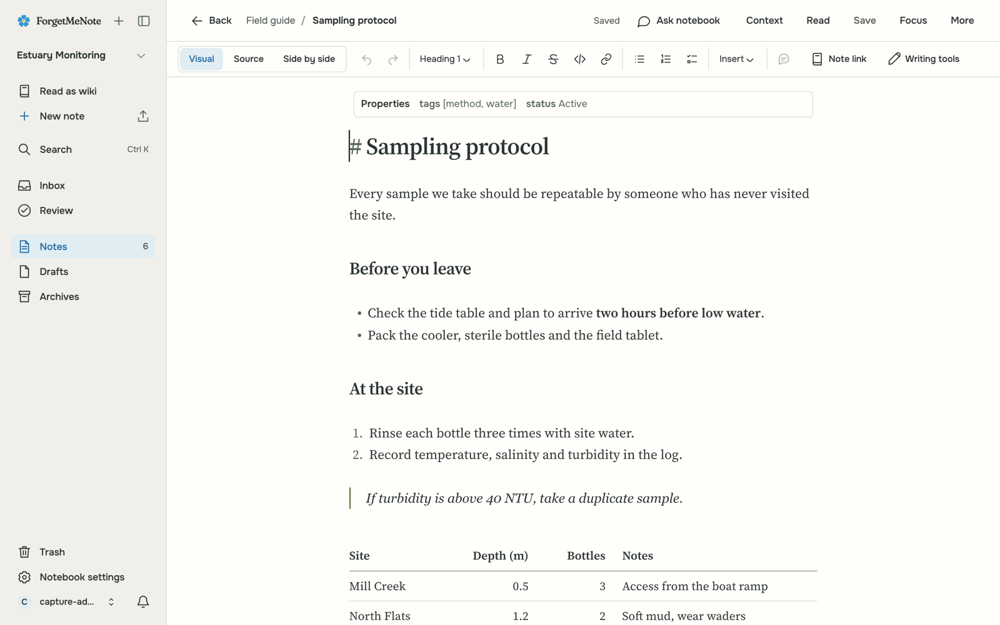

<div align="center">


# ForgetMeNote

**A collaborative operating system for AI-native companies, where people and AI work from the same
notebooks.**

Notes, agent memory, tasks and data access in one self-hosted workspace. The unit is the note:
Markdown in a notebook that has its own members, roles and Git history.

[](https://github.com/Wrightworks-Studios/forgetmenote/actions/workflows/check.yml)
[](LICENSE.md)
[](go.mod)
[](docs/ai.md)
[](https://scorecard.dev/viewer/?uri=github.com/Wrightworks-Studios/forgetmenote)

[Quick start](#quick-start) ·
[Documentation](docs/README.md) ·
[Connect an AI client](docs/ai.md) ·
[Deploy](docs/deployment.md) ·
[Contributing](CONTRIBUTING.md)

</div>

<p align="center">
  
</p>

## Why ForgetMeNote

A project or a business runs on what its people know: the plans, the decisions, who is doing what,
and how to get an answer out of the data. AI agents now do part of that work, but each one starts
from nothing, keeps what it learns where nobody else can read it, and gets either too little access
or far too much.

ForgetMeNote keeps that knowledge in one place for people and agents alike, and builds it from one
unit: **the note**. Notes live in **notebooks**, and each notebook has its own members, roles and
Git history. A plan, an agent's memory, a task queue and a guide to querying a database all live in
notebooks, so all of them are versioned, permissioned and open to correction in the same way.
**Everything is a notebook.**

- **Memory your agents share and you can correct.** Every AI client you connect reads and writes
  the same [memory](docs/memory.md), kept as Markdown in your own private notebooks, for you and
  for each project. Each item an agent writes records when it was learned, when it was last
  checked and when to recheck it. Edit one and it is pinned: agents can dispute it but never
  rewrite it, and a replaced item is retired, not deleted.
- **Data access that remembers what worked.** Operators connect PostgreSQL, Amazon Redshift and HTTP
  APIs as fixed, granted operations, and credentials stay in operator configuration, outside every
  notebook and prompt. How each source is best queried is written down as
  [profiles](deploy/integrations/README.md) in a notebook, so an agent reads what already worked
  before it writes a query. An optional learning job turns opted-in usage into new profiles, checks
  them against live results and commits them, so what one person's agent worked out helps everyone
  with access to that notebook.
- **AI with the same rules as people.** A built-in [MCP server](docs/ai.md) with OAuth lets Claude,
  ChatGPT, Codex, Cursor and other MCP clients search, read, comment on and edit notes. Every call checks the
  user's current notebook role, the scopes they consented to, and the note's revision, so an agent
  can't see more than its user or overwrite newer work.
- **Every save is a version.** Saves are Git commits. Browse history, compare, and restore any
  version as a new commit. Conflicting edits are detected instead of silently overwritten, and
  owners can purge sensitive content from every version when they need to.
- **Your notes stay yours.** Notes are plain Markdown, attachments are ordinary files, and every
  notebook exports as a standard Git repository you can clone, diff and keep without ForgetMeNote.
- **Real-time collaboration.** People and agents co-edit the same note live, with private drafts
  and device-local recovery for work that hasn't been saved yet.
- **Permissions that mean something.** Read, Comment, Edit and Owner roles per notebook, a private
  Inbox for each person, and no public links. The browser, HTTP API, CLI and MCP share one
  authorization path.
- **Simple to run, ready to grow.** One Go binary and Postgres, with no Node process at runtime.
  Start with Docker Compose on a single machine, and add gateway processes behind a load balancer
  when you need them.

## Features

**Writing and reading**

- A Markdown editor with Visual (live preview), Source and Side by side modes, built on CodeMirror 6,
  that handles book-length notes up to 32 MiB.
- Tables, task lists, code blocks, images, video embeds and attachments up to 32 MiB, stored as
  ordinary Git blobs with no Git LFS.
- Note properties (title, status, tags), folders, cover images, and Notes, Drafts and Archives.
- A wiki reading mode with `[[page links]]`, plus Light, Dark and Parchment themes.

**Collaboration**

- Live co-editing for people and agents on one shared document per note.
- Discussions and passage comments with replies and resolution, kept in the notebook's history.
- Note and folder locks, a recoverable Trash, and a Review queue for proposed changes.
- Task queues that can be assigned to one person, several people, or a group.

**Search and knowledge**

- Full-text search over current and committed history, with optional semantic search through an
  embedding service you configure.
- Archived sources: PDFs, office documents and saved email become searchable Markdown with pinned
  citations back to the original file. Connected agents read scans, images and recordings and upload
  their text with the original.
- Repository-connected notebooks: read-only snapshots of a Git repository with code search and exact
  line citations, alongside your own notes.

**AI**

- An MCP server at `/mcp` with OAuth (authorization code with PKCE, dynamic client registration,
  rotating refresh tokens) and an optional plugin for Codex and Claude Code.
- [Agent memory](docs/memory.md) over MCP (`recall_memory`, `remember`, `confirm_memory`):
  decisions, facts, preferences, commitments and lessons, per person and per project, in notebooks
  the person can read and edit.
- Integrated notebook chat that cites the notes it used, with any provider you configure: OpenAI
  Responses, Anthropic Messages, Chat Completions-compatible APIs, or a local Ollama model.
- A private Inbox for quick capture, with optional AI sorting into notebooks.
- Instance-wide AI policy: operators choose which providers, models and processing are allowed, and
  credentials never enter notebook content, prompts or logs.

**Data access**

- [Data connections](deploy/integrations/README.md) to PostgreSQL, Amazon Redshift and HTTP APIs:
  fixed operations, grants per operation, and a receipt for every call.
- Profiles: Markdown notes that record the definitions and working queries for a source, which
  agents find and read before they query.
- Optional jobs that re-check a recipe's SQL examples on a schedule and learn new profiles from
  opted-in usage.

**Administration**

- Local accounts, OIDC single sign-on, or a trusted authenticating proxy.
- Groups, invitations and automation accounts, with roles granted per notebook.
- A CLI and HTTP API for headless use, plus scheduled automations.
- A Git export of every notebook, complete instance backup and restore, and an external backup
  worker that pushes each export to a Git remote you choose.

## Quick start

You need Docker with Compose.

```sh
git clone https://github.com/Wrightworks-Studios/forgetmenote.git
cd forgetmenote
cp .env.example .env
mkdir -p data
# Set PUID and PGID in .env to the owner of ./data (see `id -u` and `id -g`).
docker compose up -d --build
docker compose exec forgetmenote forgetmenote token
```

Open **http://localhost:8080**, choose **Recovery administrator**, sign in with the key the last
command printed, and create your administrator account. Keep the recovery key somewhere safe for
emergencies.

To run ForgetMeNote on a server with HTTPS, durable storage and upgrades, follow the
[deployment guide](docs/deployment.md). Local accounts work out of the box; see
[authentication](docs/authentication.md) for OIDC or a trusted proxy. To build without integrations
you don't use, such as Slack or the database connections, set `FMN_OMIT` in `.env`; see
[optional integrations](docs/integrations.md).

### Connect an AI client

Add `https://YOUR_HOST/mcp` as a remote MCP server in any client that supports OAuth. The client
registers itself, you sign in to ForgetMeNote and approve the scopes, and the client can then work in
the notebooks your account can access. See [Connect an AI client](docs/ai.md) for Claude, ChatGPT,
Codex, Claude Code and Cursor.

## Roles

| Role | Read and export | Comment | Edit unlocked notes | Manage members and locks | Manage all notebooks and users |
| --- | :---: | :---: | :---: | :---: | :---: |
| Read | ✓ | | | | |
| Comment | ✓ | ✓ | | | |
| Edit | ✓ | ✓ | ✓ | | |
| Owner | ✓ | ✓ | ✓ | Own notebooks | |
| Admin | ✓ | ✓ | ✓ | All notebooks | ✓ |

New users see no shared notebooks until an Owner or Admin grants access. Removing a grant or disabling
a user takes effect on their next browser, API or MCP request. See
[notebooks and people](docs/workspaces.md).

## How it works

```text
 Browser · CLI · HTTP API · MCP clients
                  │
     ForgetMeNote gateways (one Go binary)
     identity · roles · revision checks
                  │
   Postgres ─────── blob store ─────── Git exports
   revisions,       large files        one bare repository
   live edits,                         per notebook, pushed
   accounts                            by the backup worker
```

Each notebook is a revision log in Postgres that uses Git's object model: every revision is an exact
Git commit and revision IDs are commit SHAs. Larger files live in a blob store, and ForgetMeNote
writes a bare Git repository for each notebook that reproduces its history byte for byte. Every
change to a notebook is one database transaction, so several gateways can serve one instance
safely. Search indexes are derived from committed content and can always be rebuilt. See
[architecture](docs/architecture.md) for the details.

The backend uses the Go standard library, the official MCP Go SDK, Goldmark and Bluemonday. The
interface is vanilla JavaScript and CSS with CodeMirror 6 and Yjs, bundled by esbuild; Node is used
only at build time.

## Documentation

| For | Start with |
| --- | --- |
| Writers | [Using ForgetMeNote](docs/editor.md) · [Live collaboration](docs/collaboration.md) · [Wiki mode](docs/wiki.md) · [Task queues](docs/tasks.md) |
| AI users | [Connect an AI client](docs/ai.md) · [Agent memory](docs/memory.md) · [Notebook chat](docs/chat.md) · [Knowledge workflows](docs/knowledge.md) · [Archived sources](docs/sources.md) |
| Operators | [Deployment](docs/deployment.md) · [Configuration](docs/instance-configuration.md) · [Authentication](docs/authentication.md) · [Backups](docs/backups.md) |
| Developers | [Contributing](CONTRIBUTING.md) · [Architecture](docs/architecture.md) · [Headless use, API and CLI](docs/headless.md) |

The [documentation index](docs/README.md) lists every guide.

## Project status

ForgetMeNote is under active development and runs in production for small teams. It has not had an
independent security audit. Test each release against your own identity provider, AI providers and
recovery plan before you rely on it, and see [SECURITY.md](SECURITY.md) for supported deployments and
how to report a vulnerability.

## Contributing

Bug reports, ideas and pull requests are welcome. [CONTRIBUTING.md](CONTRIBUTING.md) takes you from a
fresh clone to a running instance with sample notes and an open pull request.

## License

Copyright 2026 Wrightworks Studios LLC. ForgetMeNote is licensed under the
[Functional Source License, Version 1.1, ALv2 Future License](LICENSE.md). You may use, modify and
self-host it for any purpose except offering a competing commercial product or service. Each release
also becomes available under the Apache License 2.0 two years after it is published.
